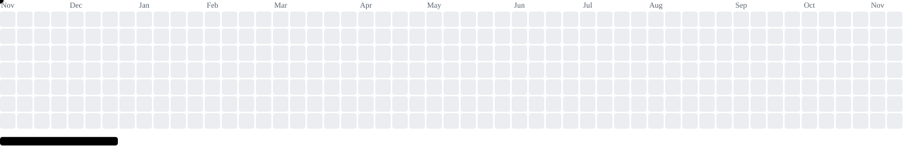

# Hi 👋, I'm Poornesh!

  

  

  

---

## 🚀 About Me

- 🎓 Computer Science Engineering student at BMSCE.
- 💻 Interested in Full Stack Development and AI Engineering.
- 🧠 Enjoy understanding how things work under the hood.
- 🛠️ Learning by building projects and experimenting.
- 🌱 Always exploring new technologies and challenging myself.

## 🛠️ Tech Stack

**Languages**

  

**Development & Tools**

  

## 💻 Featured Projects

| Project | Description |
|---|---|
| [FileMind](https://github.com/Poornesh-codes/Personal-File-Intelligence-system) | Personal file intelligence system for organizing and retrieving information from documents. |
| [IssueFit](https://github.com/punithkumar-060308/IssueFit) | An issue-ranking platform that helps contributors discover suitable open-source issues. |

## 🌱 Currently Exploring

- React.js and modern frontend development
- Node.js, Express and backend architecture
- REST APIs and database design
- Artificial Intelligence and Machine Learning
- Data Structures and Algorithms
- System design and software engineering fundamentals

## 📊 GitHub Statistics

  
  

  

## 🏆 GitHub Trophies

  

---

## 🎮 My Contribution Game

  

---

## 🤝 Connect With Me

  

---

  <i>"Great software is built one commit at a time."</i>
    
  ⭐ Thanks for visiting my profile!

